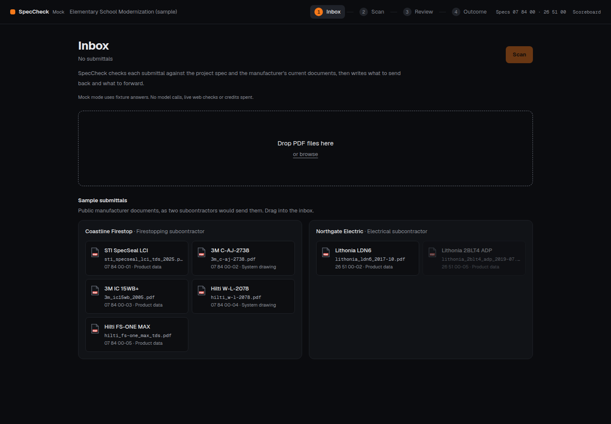
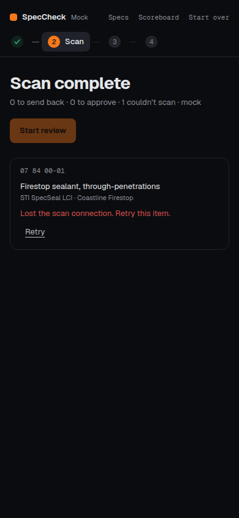

# Reliability checkpoint — 2026-10-23

G2 remains open. [Ownership and outstanding work](../ownership.md). No new full-set live eval, final recording,
deployment or cloud resource was made. Original answer keys, reviewed checklists and recording are unchanged.

## Measured validation

- [Python/browser/build verification](verification.json): **399 passed, 2 skipped in 15.96 seconds**; eight
  mock Chromium browser tests passed in **5.4 seconds**; presentation checks and production build passed.
- [Raw mock](mock-score.json), run `20261023-001855-185caa`: Panel **6/8 calls, 5/6 problems, 0/2 major false alarms, 0/5 passing replacements**,
  0 invalid items, 1 unnecessary note, **48/65 claims and 8/20 web values**. No fresh provider charges.
- [Required document preflight](document-preflight.json): all 13 frozen required PDFs match and contain native
  text; none has a low-text page. This checks the downloaded set, not the current contents of its URLs.
- [c07 live-mode retry](c07-score.json), run **`20261023-000514-d915c4`**: **1/1 call and problem**, **0/1 passing
  replacement**, 0 invalid items, 0 unnecessary notes. **6/19 claims and 29/40 web values** kept. Duration
  **6.606 seconds**, mostly cached; fresh charges **$0 / 1 credit**. Do not call this cold latency.
- [Cited result fields](c07-evidence.json): CPX L70, warranty, MacAdam, dimming and availability remain unknown.
  The linked PDF's Tavily wrapper produced no readable result; the raw API body was not retained.
  [Paired direct HTTP probe](linked-pdf-direct-probe.json) records the exact URL and 403 Cloudflare HTML.
- [Campaign status](campaign-status.json): cumulative **$1.4867368 / 359**, no outstanding holds. The October
  23 day ledger is **$0 / 1 credit**. No new private dashboard reading was supplied.

## General changes

Before: a blocked linked PDF left only product-page text. After: one linked-document Tavily hop gets its own
cache expiry and actual credit charge; a failure remains visible, and unknown evidence remains unknown.
No prompt, matcher, checklist or expectation changed in this checkpoint. The extra pre-verification credit
bound covers the possible linked-document fetch.

Other corrections: pending holds protect admission across UTC midnight; invalid watch summaries become
unverified; browser project/result/SSE errors have recovery; native PDFs are locked and build-checked; smoke
distinguishes read-only preflight from fresh proof; targeted subsets cannot pass the release gate; cloud
launches require authenticated idempotent controller admission and secret selectors, retain full history,
forward model/quality settings, and scheduler redirects cannot forward admin credentials.

The independent AI reviewer confirmed the scoped fixes after finding blank-PDF, redirect and missing-model
forwarding gaps. It did not certify cloud authority, leases, settlement/publication or deployment.

## Reproduce

```bash
SPECCHECK_MODE=mock .venv/bin/python -m pytest -q
SPECCHECK_MODE=mock .venv/bin/python scripts/eval.py --out /tmp/readiness-mock.json  # expected exit 1
SPECCHECK_MODE=mock .venv/bin/python scripts/check_pdfs.py --required --out /tmp/documents.json
cd web && npm ci && npm run test:presentation && npm run build
```

Run an isolated local server from the repo root, then the browser suite from `web/`:

```bash
SPECCHECK_MODE=mock RUNS_DIR=/tmp/speccheck-browser-runs .venv/bin/python -m uvicorn api.main:app --host 127.0.0.1 --port 8007
# Second shell, with the mock server still running:
cd web
npx playwright install chromium
npm run test:browser
```

The suite asserts mock health before any browser action. `SPECCHECK_BROWSER_URL` overrides the local URL;
`SPECCHECK_CHROMIUM_PATH` can point at an existing Chromium. CI installs Chromium and starts its own mock API.
The two screenshots below are **mock** only; they establish no live or hosted behavior.




Authorized targeted live reproduction (may spend on cache misses; stay inside campaign caps):

```bash
SPECCHECK_MODE=live MAX_OUTPUT_TOKENS=32768 INVESTIGATE_MAX_STEPS=24 INVESTIGATE_CREDIT_CAP=30 FIX_CREDIT_CAP=40 .venv/bin/python scripts/eval.py --case c07 --out /tmp/c07.json
.venv/bin/python scripts/campaign_budget.py status
```
