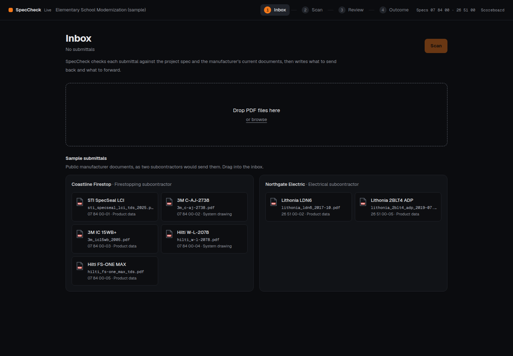
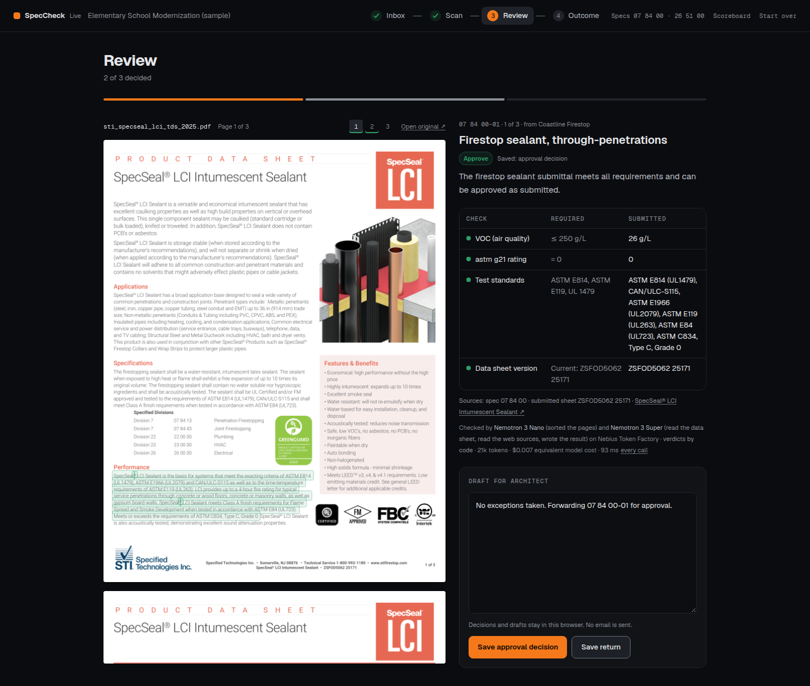
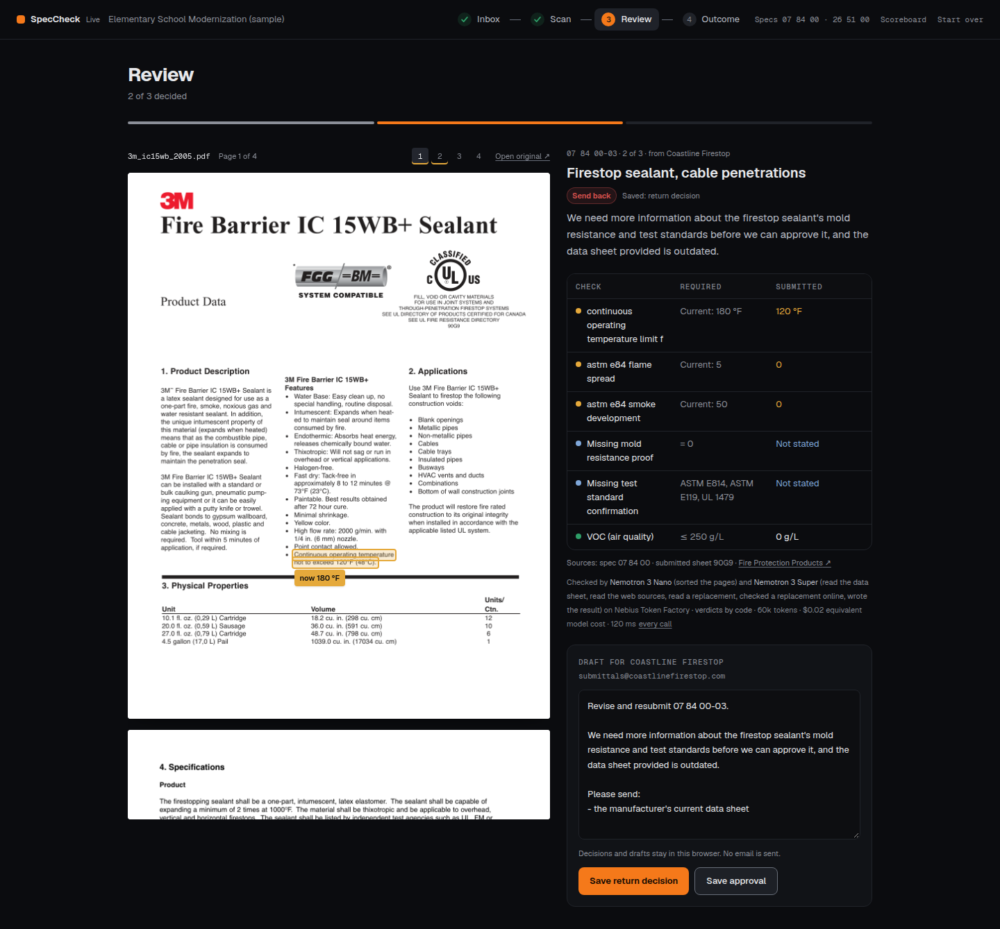
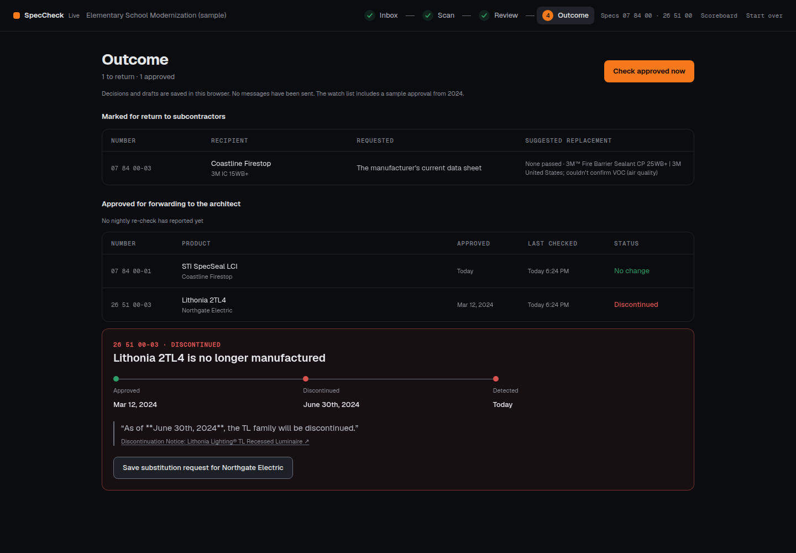
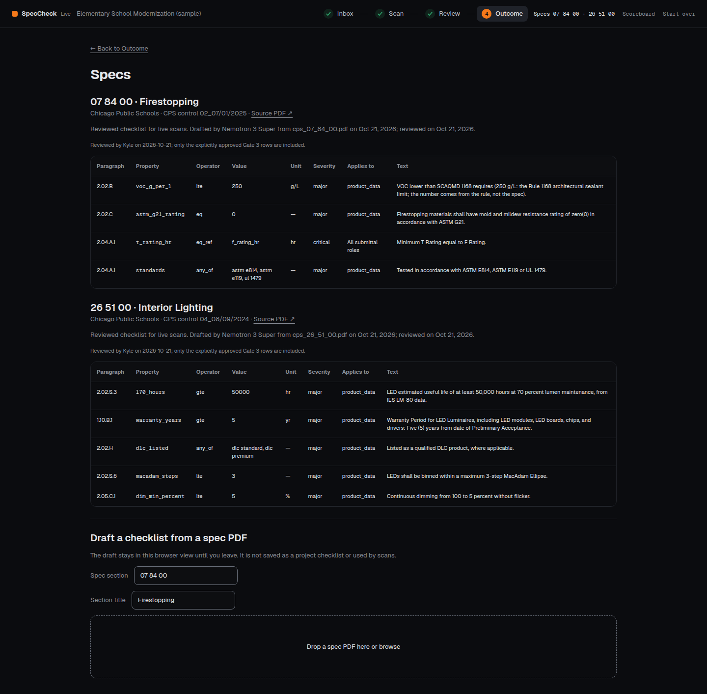
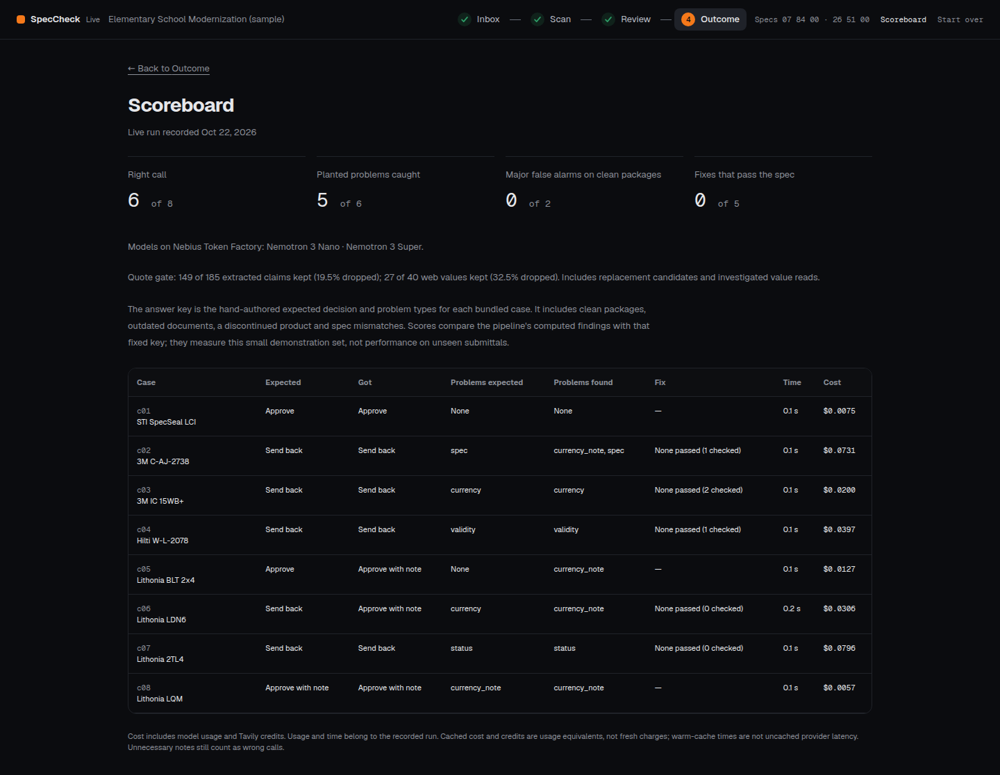
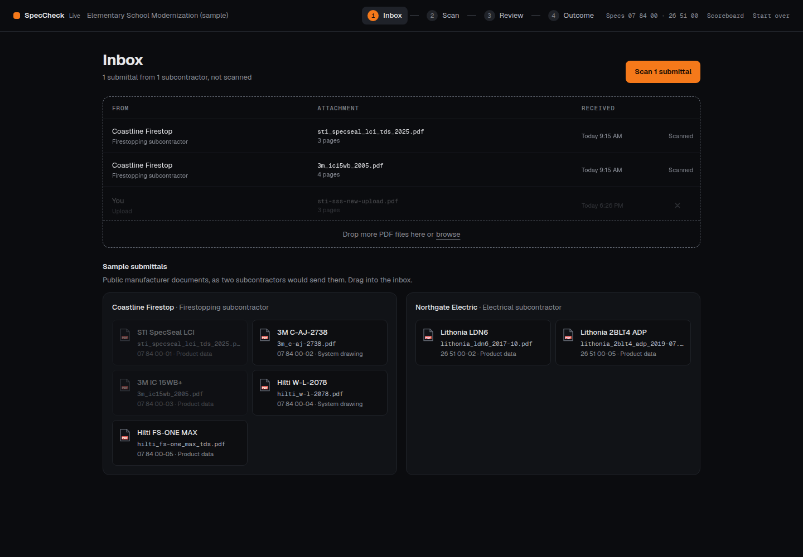
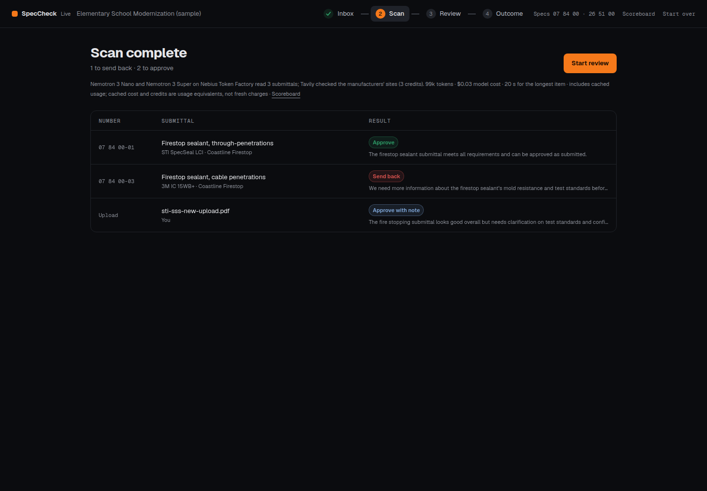

# Local live judge walk — 2026-10-22

Walked the built application in Chromium at **http://127.0.0.1:8001**. Port 8000 belonged to another project's
fixture API and was left untouched. This is local functional evidence, not a deployment or nightly-job claim.
Production spending caps were $3/run, $8/day, 60 credits/item, 600/day, concurrency 2. The measured retry
quality settings were 32,768 output tokens, 24 investigation steps, 30 shared investigation credits and
40 fix credits, supplied to the process rather than changing defaults.

## What was exercised

1. Open Inbox, add c01 and c03, Scan, open Review, inspect highlighted PDF quotes, save an approval and a return.
2. Open Outcome and press **Check approved now**. c01 returned unchanged; the bundled watched c07 returned
   discontinued with the manufacturer notice quoted. No nightly re-check report exists.
3. Open Specs: four firestop and five lighting requirements, reviewed October 21. Open Scoreboard: recorded
   live cases 6/8, problems 5/6, major false alarms 0/2, passing fixes 0/5.
4. Drop a real manufacturer PDF outside the case/sample set into Inbox without an admin token, then scan it.
   [Official STI SSS PDF source and SHA-256](new-upload-source.json); [public API result](public-upload.json).
   Upload `u-ccb0ffe5` was live, approve_with_note, three kept claims, no cap/provider warnings.
5. Run the local smoke script. Its first attempt correctly rejected an entirely cached c01 as fresh-provider
   evidence. Preserve just that Nano triage cache entry, repeat, observe a fresh call and a passing smoke.
   [Initial result](../phase6-smoke-initial.txt), [cache preparation](../phase6-smoke-cache-preparation.json),
   [passed result](../phase6-smoke.txt). No cache directory was cleared.

[Flow/run IDs and per-run ledger checkpoints](flow.json). Scan and approved-check calls were fully cached,
with $0/0 new spend. October 22's upload/smoke checks totalled **$0.009827 / 7 credits**;
[redacted provider usage summary](../phase6-live-summary.json). The full pass total is **$1.058605 / 298**.
No admin header was present on the browser upload or scan. No messages were sent.

## Observed incorrect or misleading lines

These are all incorrect or misleading lines observed in the captured walk. Sample project/sender names and
sample approval dates are labelled as samples; the live badge identifies provider mode, not a deployed service.

| Screen / observed line | Finding and final state |
| --- | --- |
| Outcome: `Invalid Date` under Discontinued | The quoted source date was `June 30th, 2024`, which JavaScript did not parse. Preserve the source label when parsing fails; now shown verbatim. [Before](06-approved-checked-before.png), [after](06-approved-checked.png). |
| Outcome: `None passed … fails on not stated` | Unknown evidence was described as a failure. Now `couldn't confirm VOC (air quality)`; candidate remains unconfirmed and is not suggested. Same before/after images. |
| Scan: `$0.03 model cost` without cached-usage qualification | Counts included historical cached usage. Final copy explicitly says cached cost and credits are usage equivalents, not fresh charges. [Before](02-scan-before.png), [after](02-scan.png). |
| Review trace: `$0.02 model cost` on cached work | Now says `equivalent model cost`; expanded trace explains cached rows are not billed again. [Before](04-return-review-before.png), [after](04-return-review.png). |
| Scoreboard: `Clean packages wrongly flagged 0 of 2` | This counter excludes unnecessary notes, which are still wrong calls. Renamed `Major false alarms on clean packages`; footnote clarifies notes, warm timing and cached usage. [Before](08-scoreboard-before.png), [after](08-scoreboard.png). |
| c01 Scan/Review summary: `meets all requirements and can be approved as submitted` | **Still too broad.** F04 is conditionally skipped when both assembly ratings are missing. This policy is unresolved; the model summary is not evidence of every possible requirement passing. Checklist/key were not changed. |
| c03 Review Sources: `submitted sheet 90G9` | **Still incorrect metadata.** 90G9 is a UL category, not a document revision. Literal quote matching cannot establish the semantic role of a number. See the case diagnosis. |
| Outcome before manual re-check: `Watching` | **Potentially misleading.** This is a browser-saved/sample approval state, not proof of scheduled monitoring. The same page says `No nightly re-check has reported yet`; no cloud schedule was verified. |

The manufacturer notice quote visibly includes Markdown `**` around the date; this is a remaining formatting
blemish, not changed source evidence. No live screen displayed a mock-mode label or an invented nightly-run
number. The public upload was a real paid check, not a fixture. Placeholder deployment/video URLs remain in
repository handoff documents and are not evidence of a public service.

The more serious judge-visible limits remain **c06/s3 missed currency/configuration problems, unnecessary
notes on clean data sheets, and zero passing live replacements**. Exact document identity and configuration
selection need general fixes before a production deployment. Details: [Gate 4 review](../gate4-review.md).

## Screenshots

The initial walk used two selected documents. Final captures after the copy fixes include the later third
public upload in Scan/Review. Outcome retains the two saved decisions and watched sample. The upload Inbox
capture was taken immediately after the drop, during its visual fade. Images are unedited browser captures;
text siblings preserve rendered copy. This was a desktop functional walk, not a mobile or accessibility audit.

### Inbox



### Scan


### Review — approval



### Review — return



### Outcome


### Check approved now



### Specs



### Scoreboard



### Public PDF drop



### Public PDF scan complete



## Reproduction

Keep secrets in private `.env`. Set the spending caps listed above, build the web app, then:

```bash
export MAX_OUTPUT_TOKENS=32768 INVESTIGATE_MAX_STEPS=24 INVESTIGATE_CREDIT_CAP=30 FIX_CREDIT_CAP=40
.venv/bin/uvicorn api.main:app --host 127.0.0.1 --port 8001
# In another shell, ADMIN_TOKEN is private in the environment:
.venv/bin/python scripts/smoke.py http://127.0.0.1:8001
```

The smoke script accepts ADMIN_TOKEN from its environment. Do not paste or echo it, or put its value in shell
history. Open the local URL and repeat the steps above; cache misses spend tokens/credits. Read the UTC budget
ledger after each run. The recorded replay can be demonstrated without fresh provider work.
